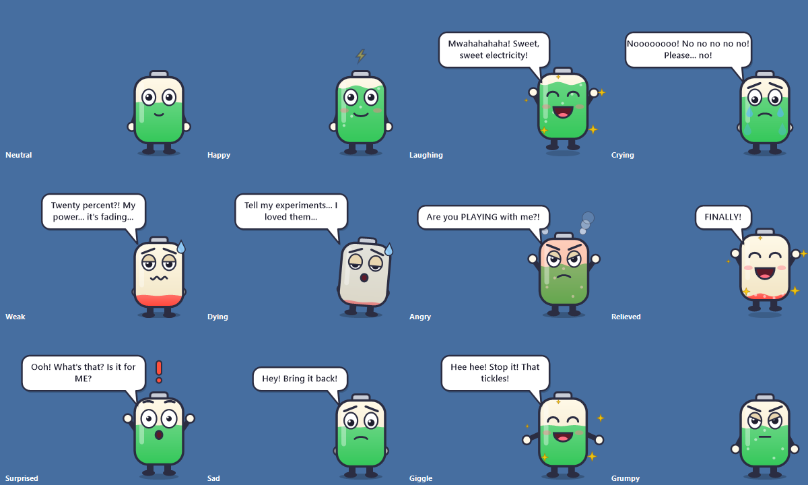

# ⚡ Charger Drama

A tiny Windows app that gives your laptop feelings about its charger. Plug the charger in and it laughs like a maniac. Pull it out and it begs: *"Nooooo! No no no no! Please... no!"* It also comes with **Volty**, a little battery mascot who lives in the corner of your screen and reacts to everything your laptop does.



## Install

1. Build it (see [Build it yourself](#build-it-yourself)) or get `ChargerDrama.exe`.
2. Double-click `ChargerDrama.exe` and choose **Yes** to install. (Choose **No** to just run it from where it is.)

- No admin rights needed. It installs for your user only, in `%LOCALAPPDATA%\ChargerDrama`.
- It puts a **Charger Drama** shortcut on your Desktop and in the Start menu. That shortcut turns the app **on/off**. Hotkey: **Ctrl + Alt + D**.
- Turning it on plays a "power-up" charging sound. Turning it off plays a "power-down" sound. No talking.
- Windows SmartScreen may warn because the exe isn't signed. Click **More info → Run anyway**.
- To uninstall, right-click the ⚡ tray icon or Volty → **Uninstall Charger Drama...**. It asks whether to keep your recorded voices and settings.

## What it reacts to

| When | What happens |
|---|---|
| Charger plugged in | maniacal laughter |
| Charger pulled out | begging "nooo" |
| Battery drops to 20% (on battery) | it gets weak and sweaty |
| Battery drops to 5% | dramatic last words |
| You plug/unplug 3+ times within 45 seconds | it gets annoyed: "Are you PLAYING with me?!" |
| Plugged in after 30+ minutes on battery, or at low battery | huge relief: "FINALLY!" |
| USB stick plugged in / removed | curious / "Hey, bring it back!" |
| Mouse connected / disconnected | says hi / misses it |
| You click Volty | giggles: "That tickles!" |

Each battery warning plays once per discharge.

## Volty the mascot

- A little battery character in the bottom-right corner, always on top.
- Its "liquid" shows your real battery level (green, yellow or red) and bubbles while charging.
- Its eyes follow your mouse.
- Each line appears in a speech bubble.
- Drag it anywhere. Its position is remembered.
- Click it to poke it. Right-click it for the menu.
- It hides automatically during fullscreen apps, games and presentations.

Mascot menu options:

- **Always visible**
- **Only when something happens**
- **Hidden**
- **Move back to the corner**

## Stays quiet during calls

When another app is using your microphone (Teams, Zoom, Discord, ...), Charger Drama doesn't make sound. Volty shows the line in a bubble instead, with a little muted icon.

To toggle this, use the tray menu → **Stay quiet during calls (mic in use)**. It is on by default.

## Voices

| Voice | Style |
|---|---|
| **Mad Scientist** (default) | escalating evil laugh |
| Drama Queen | over-the-top theatrical |
| British Villain | calm, menacing |
| Italian Drama | *"Mamma mia! No no no no! Ti prego, no!"* |
| Cartoon Kid | giggly, "No fair!" |
| Classic Robot | the built-in Windows voice |

Each character has 26 lines across all the reactions, picked at random.

Switch voices with right-click → **Voice**. To try any reaction without touching a cable, right-click → **Try a reaction**.

### Record your own voice

1. Right-click → **Record my own voice...**
2. Pick a reaction on the left.
3. Press **Record**, say something, then press **Stop**. Each take can be up to 15 seconds.

Record 2-3 takes per reaction for variety. Your voice appears under **Voice** and is used automatically after recording. Reactions you didn't record fall back to the Windows voice.

Recordings are saved in `%APPDATA%\ChargerDrama\voices\<name>`. You can also drop your own `.mp3`, `.wav` or `.m4a` files there, named after the reaction, e.g. `laugh-1.mp3` or `nooo-1.m4a`.

Reaction file names: `laugh`, `nooo`, `low20`, `low5`, `annoyed`, `relief`, `usb-in`, `usb-out`, `mouse-in`, `mouse-out`, `poke`.

## Start with Windows

Right-click → **Start with Windows**. The app starts quietly at login, without the power-up sound.

## Build it yourself

No Visual Studio or SDK needed. The build uses the C# compiler that ships with Windows (.NET Framework 4.8).

```bash
build.cmd
```

Or in PowerShell:

```powershell
.\build.ps1
```

Add `-Test` to run the silent self-test. It also renders every mascot mood to `dist\selftest\mascot-moods.png`.

Output: `dist\ChargerDrama.exe` (about 4 MB, voices included).

### Change the AI voice lines

The voice packs in `sounds/` were made with Microsoft's neural voices via [edge-tts](https://github.com/rany2/edge-tts). To change the lines, edit `tools/make_voices.py`, then run:

```bash
pip install -r tools/requirements.txt
python tools/make_voices.py
```

Only missing clips are made. Add `--force` to remake all of them. Then rebuild.

## Project layout

| Path | What it is |
|---|---|
| `src/` | C# source. `TrayApp.cs` is the brain, `Mascot.cs` is Volty, plus `Installer.cs`, `RecorderForm.cs`, `DeviceWatcher.cs`, `MicWatcher.cs`, `SoundFx.cs` (power-up/down sounds) and `VoiceLibrary.cs` |
| `sounds/` | voice packs, one folder per character, with `lines.json` captions |
| `assets/` | app icon and manifest |
| `tools/make_voices.py` | voice generator |
| `build.ps1` / `build.cmd` | build script |
